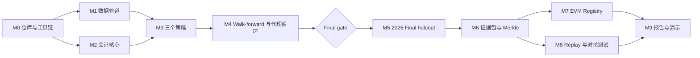

# MSBD5017 项目实施计划（PLAN）

## Blockchain-Anchored Multi-Strategy Portfolio Back-testing & Execution Framework

| 字段 | 值 |
| --- | --- |
| 计划版本 | 1.0.0 |
| 日期 | 2026-11-14 |
| 规格基线 | `SPEC.md` 1.0.0-frozen |
| 当前状态 | M0-M5 已完成；M6 evidence/Merkle 代码与测试已完成；尚未正式生成 bundle |
| 预计净工作量 | 18-25 个开发日，不含课程报告反复修改时间 |

本计划负责回答“按什么顺序完成项目”。所有技术规则以 `SPEC.md` 为准；PLAN 不得静默修改 SPEC。遇到必须改变数据、时间切分、指标、成本或 Merkle 规则的情况，应先提升 SPEC 版本，再更新本计划。

---

## 1. 完成路线概览



关键路径：

```text
仓库 → 数据 → 会计 → 策略 → Walk-forward → 参数冻结
→ Final holdout → Evidence → Merkle → EVM/Replay → 报告
```

2025 final holdout 在 M5 之前不得被策略开发、调参或代理读取。

---

## 2. 推荐技术栈

### 2.1 核心实现

| 模块 | 技术选择 | 原因 |
| --- | --- | --- |
| 主语言 | Go 1.24+ | 与 Argo Trading framework 一致，适合确定性 CLI 和并发策略运行 |
| 策略插件 | Go WASM / Argo strategy API | 对齐现有 Argo 设计，策略隔离且方便复用 |
| 本地分析存储 | DuckDB | Argo 已支持，适合日线窗口查询和结果检查 |
| 数据交换 | Canonical CSV + JCS JSON | 便于独立验证和字节级重放 |
| 单元测试 | Go `testing` | 无额外运行时依赖 |
| 智能合约 | Solidity 0.8.x | EVM registry 和 SHA-256 proof verifier |
| 合约工具 | Foundry + Anvil | 本地链、测试、部署和 gas report 简洁 |
| 自动化 | Makefile | 统一下载、测试、回测、证据和演示命令 |

### 2.2 代理适配

核心回测不得依赖代理供应商。实现一个窄接口：

```text
AgentProposer.Propose(context, search_state) -> candidate_parameters
```

第一实现建议使用 Codex app-server 的本地 stdio 接口和 ChatGPT 登录；Claude Agent SDK 作为可选 adapter。两种 adapter 都必须输出同一个 JSON schema。没有可用订阅时，可以使用 `manual` adapter 手工提供候选参数，确保核心实验仍可运行。

### 2.3 不在 MVP 中实现

- macOS SwiftUI UI；
- 公开测试网；
- IPFS；
- 实盘接口；
- 通用策略编辑器；
- 复杂数据库服务；
- 多模型投票代理。

这些只能在 M9 以后作为增强项处理。

---

## 3. 目标目录结构

```text
MSBD_BC/
├── SPEC.md
├── PLAN.md
├── README.md
├── Makefile
├── go.mod
├── go.sum
├── cmd/
│   └── project/                 # 单一 CLI 入口
├── internal/
│   ├── canonical/              # CSV/JCS 和数值量化
│   ├── data/                   # 下载、checksum、校验、规范化
│   ├── domain/                 # 订单、成交、持仓、账本类型
│   ├── execution/              # 成交、成本、现金和会计
│   ├── experiment/             # split、fold、selection、regime
│   ├── portfolio/              # ensemble allocator
│   ├── evidence/               # bundle、manifest、run ID
│   ├── merkle/                 # SHA-256 tree 和 proof
│   ├── replay/                 # deterministic replay 和 diff
│   └── agent/                  # proposer interface 与 adapters
├── strategies/
│   ├── buyhold/
│   ├── trend/
│   └── meanreversion/
├── contracts/
│   ├── src/BacktestRegistry.sol
│   ├── test/BacktestRegistry.t.sol
│   └── script/Deploy.s.sol
├── configs/
│   ├── experiment.json
│   ├── costs.json
│   └── schemas/
├── data/
│   ├── LICENSE_DATA.md
│   ├── raw/                    # 默认不提交大文件到 Git
│   └── normalized/
├── artifacts/                 # 默认不提交运行产物到 Git
├── scripts/
├── tests/
│   ├── fixtures/
│   └── golden/
└── reports/
```

---

## 4. 里程碑计划

## M0：仓库、工具链和项目骨架

预计：0.5-1 天。

### 任务

- 初始化 Git；
- 创建 `.gitignore`、`README.md`、`Makefile`；
- 初始化 Go module；
- 检查 Go、Foundry、Anvil、Node/Codex 的可用版本；
- 建立目录结构；
- 保存 `SPEC.md` 和 `PLAN.md`；
- 创建最小 CI 命令；
- 标记 `spec-v1.0.0` tag。

### 输出

- 可编译的空 CLI；
- `make test` 能成功运行；
- 环境预检命令；
- 第一份 clean Git commit。

### 退出门槛

- Git 工作区 clean；
- `go test ./...` 通过；
- SPEC tag 存在；
- 任何人可以从 README 找到构建命令。

---

## M1：数据下载、校验和规范化

预计：1.5-2.5 天。依赖 M0。

### 任务

- 实现 Binance Vision 月度文件 URL 生成器；
- 下载 180 个 zip 和对应 checksum；
- 对下载文件做 checksum 验证；
- 解压并解析三种资产的 `1d` klines；
- 正确处理 2025 年微秒时间戳变化；
- 校验日期连续性、重复值、OHLC 关系和有限数值；
- 生成 `daily_ohlcv.csv`；
- 生成 `data_manifest.json` 和校验报告；
- 写入 Binance Vision attribution。

### 测试

- checksum mismatch 必须失败；
- 缺失日期必须失败；
- 重复日期必须失败；
- 毫秒和微秒 fixture 必须解析为同一 UTC 语义；
- 非法 OHLC 必须失败；
- 相同输入两次生成的 normalized CSV 必须逐字节一致。

### 输出

- 固定 raw snapshot；
- `data/normalized/daily_ohlcv.csv`；
- data manifest；
- validation report。

### 退出门槛

- 三个资产覆盖 2021-01-01 至 2025-12-31；
- 无缺失和重复日期；
- 所有官方 checksum 通过；
- normalized 数据重复生成 hash 相同。

---

## M2：领域模型和执行会计核心

预计：2-3 天。依赖 M0，可与 M1 部分并行。

### 任务

- 定义 MarketBar、Signal、TargetWeight、Order、Trade、Position、LedgerEntry；
- 实现卖单优先和 symbol 排序；
- 实现 8 位数量精度和 10 USDT 最小名义金额；
- 实现 commission、slippage 和现金约束；
- 实现目标权重到交易数量的转换；
- 实现现金、持仓市值、gross/net PnL 和 equity；
- 实现会计残差检查；
- 实现确定性事件序号。

### 测试

- 使用手工构造的 5-10 日小数据；
- 纯现金、只买入、买入后卖出、跨资产调仓；
- 现金不足时按比例缩单；
- 最小交易金额跳过；
- 佣金和滑点公式；
- accounting residual `< 1e-10`；
- 输入顺序改变不能改变最终账本。

### 输出

- 独立 execution package；
- golden ledger fixtures；
- 会计测试报告。

### 退出门槛

- 所有 golden fixtures 通过；
- 会计残差达标；
- 账本结果与 map iteration、并发完成顺序无关。

---

## M3：三种基础策略与 Argo 集成

预计：3-4 天。依赖 M1、M2。

### 任务

- 实现 Buy-and-hold；
- 实现 fast/slow SMA trend；
- 实现有状态 z-score mean reversion；
- 通过 Argo `GetRange` 或 DuckDB 计算双均线；
- 为三个策略建立统一 signal/weight 输出；
- 实现第 `d` 日信号、第 `d+1` 日收盘执行；
- 实现三个策略并行运行；
- 在汇总阶段做稳定排序，消除并发顺序影响。

### 测试

- Buy-and-hold 只有初始交易；
- MA warm-up 期间保持现金；
- 均线交叉信号边界测试；
- z-score entry、hold、exit 状态测试；
- standard deviation 为零时保持现金；
- 修改未来数据不得改变历史信号；
- 串行与并行运行输出逐字节一致。

### 输出

- 三个策略模块/WASM；
- base strategy signals、weights、returns；
- no-look-ahead test suite。

### 退出门槛

- 三策略完成整个 development 区间；
- exposure 始终在 `[0,1]`；
- 无前视测试全部通过；
- 串行/并行结果一致。

---

## M4：Walk-forward、指标、Ensemble 和代理循环

预计：3-4 天。依赖 M3。

### 任务

- 实现四个 walk-forward folds；
- 实现 SPEC 第 12 节全部指标；
- 实现 lagged reliability/inverse-volatility allocator；
- 实现参数 JSON schema 和 canonical config ID；
- 实现候选评估缓存，避免重复回测；
- 实现固定第一个 baseline candidate；
- 实现 AgentProposer 接口；
- 接入 Codex app-server adapter；
- 保存 `search_trace.jsonl`；
- 达到 20 个候选后按冻结规则选择参数；
- 生成 `selected_parameters.json`。

### 代理安全门

- 代理只收到 development fold 指标；
- 代理工具不得读取 2025 文件；
- 参数必须通过 schema 和候选范围校验；
- 重复候选不得覆盖历史；
- 每轮输入输出进入结构化 trace；
- 代理不可直接修改指标代码或数据。

### 测试

- 每个 fold 日期边界正确；
- reliability 和 volatility 使用 `d-1` 及之前数据；
- 所有 score 为零时 ensemble 全现金；
- tie-break 完全确定；
- 无代理时 manual adapter 可运行；
- search trace 规范化后可重复 hash。

### 输出

- fold metrics；
- 20 个以内的候选 trace；
- selected parameters；
- 参数选择报告。

### 退出门槛：Final gate

必须全部满足：

- 参数和代码已冻结；
- `selected_parameters.json` 已生成；
- development 测试全部通过；
- 核心覆盖率达到 85% 或有明确差距清单；
- Git 工作区 clean；
- 生成 pre-final tag，例如 `pre-final-v1`；
- 尚未产生任何 2025 策略绩效报告。

---

## M5：最终样本外实验

预计：1-1.5 天。依赖 M4 Final gate。

### 任务

- 使用冻结参数运行 2025 final holdout；
- 运行三个基础策略和 ensemble；
- 生成 gross/net results；
- 计算总体指标；
- 计算四种市场状态指标；
- 执行参数和成本 ±20% sensitivity；
- 保存 final run log 和 commit identity。

### 纪律

- 正式结果生成后不得重新调参；
- 若发生软件缺陷，只能修复明确 bug；
- bug fix 必须记录 commit、原因和影响分析；
- 修复后必须重新运行全部 development 回归测试；
- 不得只选择有利的 rerun。

### 输出

- final holdout results；
- regime metrics；
- sensitivity report；
- frozen final configuration。

### 退出门槛

- 所有指标无 NaN/Infinity；
- exposure 和会计残差达标；
- 结果可由同一 commit 重跑；
- final 结果不反馈给参数选择模块。

---

## M6：Canonical evidence bundle 与 Merkle

预计：3-4 天。依赖 M5。

### 任务

- 实现固定 12 位小数和 half-even 量化；
- 实现 JCS JSON 和稳定 CSV；
- 实现 source/data/run manifests；
- 实现确定性 run ID；
- 实现 SPEC 规定的 bundle 文件集合；
- 实现 domain-separated SHA-256 leaves；
- 实现有序 Merkle tree；
- 实现 odd-node duplication；
- 为每个 leaf 生成方向 proof；
- 实现 bundle verifier。

### 测试

- Unicode NFC、LF、负零、null reason；
- 文件路径绑定；
- 改名、改长度、改内容均导致 leaf 改变；
- odd/even leaf count；
- 左右方向错误必须验证失败；
- 所有 leaves proof 验证成功；
- 规范化输出重复生成逐字节一致。

### 输出

- 完整 evidence bundle；
- Merkle root；
- leaf manifest；
- all proofs。

### 退出门槛

- 全部 leaves proof 通过；
- 同一输入连续 10 次构建 root 一致；
- 不包含 wall-clock、绝对路径、用户名或 PID。

---

## M7：Solidity Registry 和链上 proof

预计：2-2.5 天。依赖 M6，可与 M8 部分并行。

### 任务

- 实现 `BacktestRegistry.sol`；
- 实现 zero root 和 duplicate root rejection；
- 实现 event 和 public record getter；
- 实现 `verifyStoredProof`；
- 使用 Solidity `sha256` 对 internal nodes 进行有序验证；
- 编写 Foundry 单元和 fuzz tests；
- 部署到本地 Anvil；
- 提交 final root；
- 使用一个真实 artifact proof 做链上验证；
- 生成 deployment、receipt 和 gas report。

### 测试

- 首次 root 提交成功；
- duplicate/zero root revert；
- event 与 storage 一致；
- sibling 长度不一致失败；
- 正确 proof 返回 true；
- 修改 leaf、sibling、方向位后失败；
- 离线与链上结果一致。

### 输出

- 合约源码、测试和部署脚本；
- 本地地址和交易回执；
- root submission gas；
- 不同 proof depth 的 gas estimate。

### 退出门槛

- Foundry tests 全部通过；
- final root 可从 registry 查询；
- 至少一个真实 proof 链上验证成功。

---

## M8：Replay、mutation 和质量保证

预计：2-3 天。依赖 M6，可与 M7 部分并行。

### 任务

- 实现从 bundle 重放；
- 重新计算全部生成 artifacts；
- 提供首个文件/字段/字节差异定位；
- 连续进行 10 次 clean replay；
- 进行 seed 5017 的 100 次单字节 mutation；
- 生成覆盖率、性能和存储开销报告；
- 测量普通回测与证据化回测的时间差。

### 测试

- replay 不得发起代理调用或网络下载；
- 10/10 artifacts byte-identical；
- 10/10 root 相同；
- 100/100 mutation 检测；
- 100/100 定位到修改文件；
- 未修改 bundle 始终通过。

### 输出

- replay report；
- mutation report；
- coverage report；
- overhead report。

### 退出门槛

- 达到 proposal 中全部量化 QA 指标；
- 无未解释的 nondeterminism；
- 核心测试覆盖率 `>=85%`。

---

## M9：技术报告和演示

预计：2-3 天。依赖 M7、M8。

### 任务

- 完成研究问题、方法、结果和局限；
- 绘制总体表现、回撤、权重、成本和市场状态图；
- 报告参数选择过程而非只报告最佳结果；
- 报告 deterministic root、mutation、proof 和 gas；
- 准备端到端演示脚本；
- 从空环境做一次最终 rehearsal；
- 整理 D1、D2、D3。

### 演示顺序

```text
1. 验证固定数据和配置
2. 运行 final backtest 或展示冻结结果
3. 展示策略、ensemble 和风险指标
4. 构造 evidence bundle 与 Merkle root
5. 提交 root 到本地 EVM
6. 离线及链上验证一个 artifact proof
7. 修改一个字节并展示验证失败和定位
8. replay 并得到相同 root
9. 展示 gas、开销和系统局限
```

### 退出门槛

- 新环境按 README 可以完成演示；
- D1、D2、D3 文件齐全；
- 所有表格和图可以追溯到 evidence bundle；
- 报告不声称区块链证明数据真实或策略盈利。

---

## 5. 任务优先级 Backlog

### P0：阻塞关键路径

- `P0-01` 初始化 Git 和 Go module；
- `P0-02` 数据 downloader/checksum validator；
- `P0-03` canonical daily CSV；
- `P0-04` execution accounting；
- `P0-05` no-look-ahead convention；
- `P0-06` 三个基础策略；
- `P0-07` walk-forward evaluator；
- `P0-08` selected parameters freeze；
- `P0-09` final holdout；
- `P0-10` evidence/Merkle/verifier；
- `P0-11` EVM registry；
- `P0-12` replay/mutation。

### P1：最终交付必需但不阻塞早期开发

- `P1-01` Codex agent adapter；
- `P1-02` regime analysis；
- `P1-03` sensitivity runner；
- `P1-04` gas/overhead reports；
- `P1-05` report charts；
- `P1-06` one-command demo。

### P2：可选增强

- `P2-01` Claude Agent SDK adapter；
- `P2-02` macOS UI；
- `P2-03` 第二宿主环境复现；
- `P2-04` public testnet；
- `P2-05` bundle URI/IPFS。

---

## 6. 预期命令接口

```bash
make bootstrap
make test
make data
make strategies
make development
make select-parameters
make final
make evidence
make contracts
make anchor
make verify
make replay
make mutation
make report
make demo
```

底层 CLI 预计为：

```bash
project doctor
project data download
project data validate
project data normalize
project backtest --period development
project search --max-candidates 20
project backtest --period final --frozen
project evidence build
project evidence verify
project merkle prove --path results/trades.csv
project chain deploy
project chain anchor
project chain verify-proof
project replay
project mutate-test --count 100 --seed 5017
```

---

## 7. Commit 计划

建议保持每个 commit 单一、可测试、可回退：

1. `chore: bootstrap repository and toolchain checks`
2. `feat: add Binance data downloader and checksum validation`
3. `feat: normalize and validate daily OHLCV data`
4. `feat: implement deterministic execution ledger`
5. `feat: add buy-and-hold strategy`
6. `feat: add lagged moving-average trend strategy`
7. `feat: add lagged z-score mean-reversion strategy`
8. `feat: run strategies in parallel with stable output ordering`
9. `feat: add metrics and walk-forward evaluation`
10. `feat: add lagged ensemble allocator`
11. `feat: add bounded agent parameter proposer`
12. `chore: freeze selected parameters before final holdout`
13. `feat: run and record final holdout experiment`
14. `feat: build canonical evidence bundle`
15. `feat: add ordered SHA-256 Merkle proofs`
16. `feat: add backtest registry and on-chain proof verification`
17. `test: add deterministic replay and mutation suite`
18. `docs: add evaluation report and demo workflow`

涉及 final holdout 的 commit 必须清楚标注，不能通过 amend 或 rebase 隐藏首次正式结果。

---

## 8. 风险与应对

| 风险 | 影响 | 应对 |
| --- | --- | --- |
| Argo API 与当前文档不一致 | 策略集成延期 | 先实现独立 domain/execution 核心；Argo 只做 adapter，不让业务逻辑耦合框架 |
| 2025 微秒时间戳误读 | 日期完全错误 | 专门 fixture、显式单位规则和跨边界测试 |
| 双 SMA 不能用两个同类 indicator | 趋势策略受阻 | 使用 `GetRange` 或 DuckDB SQL 手工计算 |
| 代理输出不稳定或不可用 | 参数搜索停滞 | 固定 schema、manual adapter、冻结 trace，不让 final replay 调模型 |
| final holdout 被提前查看 | 样本外结论失效 | 目录/命令门禁、pre-final tag、正式结果审计日志 |
| 浮点差异导致 root 不一致 | 复现失败 | 计算顺序固定、输出量化 12 位、golden tests、容器化 |
| 并发日志顺序变化 | 字节不一致 | 并发计算、串行稳定归并；事件使用确定性 sequence |
| SHA-256 与 OpenZeppelin 不兼容 | proof 失败 | 自定义有序 SHA-256 verifier，不使用默认 MerkleProof |
| 数据许可遗漏 | 交付风险 | `LICENSE_DATA.md`、attribution、非商业用途声明 |
| 项目范围过大 | 不能按时完成 | UI、IPFS、测试网均放到 P2，先完成 CLI MVP |

---

## 9. Definition of Done

项目只有同时满足以下条件才算完成：

- 固定数据、配置、源码身份齐全；
- 三个策略和 ensemble 无前视；
- 2025 final holdout 未参与参数选择；
- 至少八项金融指标和 ±20% sensitivity 完成；
- 会计残差 `<1e-10`；
- 10/10 clean replay root 相同；
- 全部 proofs 离线验证；
- 至少一个真实 artifact proof 链上验证；
- duplicate root 被拒绝；
- 100/100 单字节 mutation 被检测并定位；
- 核心覆盖率 `>=85%`；
- deployment、receipt 和 gas report 完整；
- README 能指导第三方从零完成验证；
- 报告清楚陈述系统能力和限制。

---

## 10. 现在立即执行的下一步

下一步只做 M0，不碰策略和 final 数据：

1. 初始化 Git；
2. 创建目录、`.gitignore`、README、Makefile 和 Go module；
3. 实现 `project doctor` 检查 Go、Argo、Foundry、Anvil、Node/Codex；
4. 加入最小测试和 CI 命令；
5. 提交第一个 clean commit；
6. 创建 `spec-v1.0.0` tag；
7. 然后进入 M1 数据管道。
