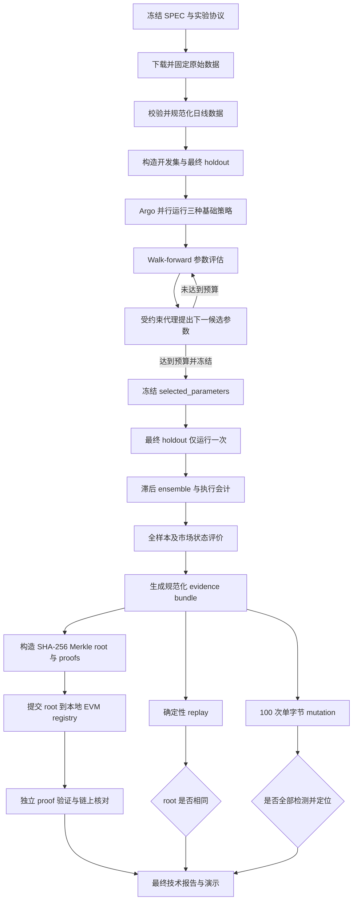

# MSBD5017 项目技术规格（SPEC）

## Blockchain-Anchored Multi-Strategy Portfolio Back-testing & Execution Framework

| 字段 | 值 |
| --- | --- |
| 文档版本 | 1.0.0-frozen |
| 日期 | 2026-11-14 |
| 状态 | 已冻结，可开始实现 |
| 目标 | 将项目 proposal 转化为可编码、可测试、可复现的规范 |

本文中的“必须”表示验收所需的强制要求，“应该”表示默认实现要求，“可以”表示非必要增强。若实现与本文不一致，必须修改本文版本并在变更记录中说明原因，不能静默改变实验规则。

---

## 1. 研究目标与可验证主张

### 1.1 研究问题

本项目研究：确定性执行和 EVM 锚定的密码学承诺，在多策略投资组合回测中，能够在多大程度上提高：

1. 独立可复现性；
2. 选择性可审计性；
3. 篡改可检测性；
4. 同时引入多少运行、存储和链上 gas 开销。

### 1.2 系统可以证明什么

系统必须能够证明：

- 某次运行使用了指定的数据、配置、源码身份和执行规则；
- 某个 artifact 属于已锚定的 Merkle root；
- 指定证据包可以在冻结环境中重新生成相同的规范化输出和 Merkle root；
- 对进入 Merkle 树的文件进行修改会被检测并定位到对应 leaf。

### 1.3 系统不能证明什么

系统不得声称：

- 数据供应方提供的市场数据必然真实；
- 策略未来能够盈利；
- 本地 EVM 具有公链最终性；
- Merkle root 可以替代金融模型验证；
- 区块链能够消除回测过拟合；
- 代理生成的参数天然优于确定性搜索。

---

## 2. 范围与非目标

### 2.1 范围内

- 三种现货加密资产；
- UTC 日线 OHLCV；
- long/cash，不做空；
- Buy-and-hold、均线趋势、z-score 均值回归；
- 一个滞后的 reliability/inverse-volatility ensemble；
- 固定佣金和固定滑点；
- 时序 walk-forward 参数选择；
- 最终样本外 holdout；
- 滞后定义的市场状态比较；
- 受约束的代理候选参数循环；
- 规范化证据包、SHA-256 Merkle 树和 inclusion proof；
- 本地 EVM registry；
- 独立 verifier、deterministic replay 和 mutation tests。

### 2.2 范围外

- 实盘下单和交易所账户连接；
- 杠杆、做空、借币成本和资金费率；
- 订单簿冲击与部分成交模型；
- 税务；
- 股票分红、拆股等 corporate actions；
- 私有数据保密或零知识证明；
- 公链部署及其经济最终性；
- 高频或日内信号；
- 用最终测试结果继续调参。

---

## 3. 总体架构



核心实现必须分为四层：

1. **Argo 策略运行层**：读取日线数据、产生信号和基础策略目标权重；
2. **实验与会计层**：时序切分、参数评估、ensemble、成交、现金和净值；
3. **证据与验证层**：规范化序列化、Merkle、proof、replay、mutation；
4. **EVM 锚定层**：保存 root、metadata hash、submitter 和 block timestamp。

macOS SwiftUI 应用可以作为最后的可视化界面，但不得成为 replay 或 verifier 的必要依赖。

---

## 4. 数据规格

### 4.1 资产

必须使用以下三个 Binance Spot 交易对：

| 资产 | 交易对 | 计价货币 |
| --- | --- | --- |
| Bitcoin | BTCUSDT | USDT |
| Ether | ETHUSDT | USDT |
| Solana | SOLUSDT | USDT |

现金按 USDT 记录，并在本项目中固定假设 `1 USDT = 1 USD`。项目不研究 USDT 脱锚风险。

### 4.2 数据来源与区间

- 数据供应方：Binance Spot public market data；
- 固定获取渠道：Binance Vision 的历史 kline 压缩包；
- 频率：`1d`；
- 原始区间：`2021-01-01T00:00:00Z` 至 `2025-12-31T23:59:59Z`；
- 统一时区：UTC；
- 每根日线以 Binance 的 UTC candle 定义为准；
- 原始字段：open time、open、high、low、close、volume、close time，以及供应方提供的其他原始字段；
- 策略主价格字段：`close`；
- 原始压缩包和解压文件必须保存 SHA-256、原始 URL、下载日期、字节数和行数。

Binance public-data 文档说明，2025-01-01 起 Spot 数据时间戳从毫秒切换为微秒。数据加载器必须根据官方规则明确处理该边界，转换到 UTC 时不得用模糊的自动猜测；转换前后的整数时间戳和单位必须写入数据校验日志。

Binance Vision Dataset Terms 允许学术研究、非商业教育和个人非生产历史回测，但要求遵守 CC BY-NC-SA 4.0 和署名义务。因此：

- 本项目数据用途固定为非商业课程研究；
- bundle 必须包含 `data/LICENSE_DATA.md`，记录 Binance Vision attribution、条款版本和访问日期；
- 若对外重新分发原始数据或衍生数据，必须保留相同许可和署名；
- 不得暗示 Binance 赞助、认可或合作；
- 若未来转为商业产品，必须重新取得适当的数据许可，本 SPEC 的许可判断不再适用。

选择完整结束于 2025-12-31 的区间，是为了避免 2026 年未结束数据造成样本长度和结果变化。

### 4.3 数据校验

规范化前必须检查：

- 三个资产是否覆盖全部 UTC 日期；
- 是否存在重复日期；
- 日期是否严格递增；
- OHLC 是否为有限正数；
- volume 是否为有限非负数；
- `low <= min(open, close) <= max(open, close) <= high`；
- 是否有缺失字段、空值、NaN 或 Infinity。

本项目禁止对缺失 OHLC 进行 forward-fill 或插值。发现任意缺失、重复或非法日线时，数据构建必须失败并输出校验报告；修复只能通过重新获取数据或提交有版本记录的数据修订规则完成。

### 4.4 规范化数据格式

规范化文件路径：

```text
data/normalized/daily_ohlcv.csv
```

行排序必须为：

```text
date ASC, symbol ASC
```

列顺序固定为：

```text
date,symbol,open,high,low,close,volume
```

`date` 必须为 `YYYY-MM-DD`。所有数值必须按第 13.2 节的确定性序列化规则输出。

---

## 5. 初始资本、成交和成本

### 5.1 初始状态

- 初始资本：`1,000,000.00 USDT`；
- 初始持仓：全部为零；
- 初始现金：全部初始资本；
- 允许资产数量精度：小数点后 8 位；
- 最小成交名义金额：`10.00 USDT`；
- 小于最小成交金额的订单必须跳过并记录确定性事件；
- 禁止负现金，因浮点舍入产生的小于 `1e-8 USDT` 的负值可以归一化为零并记录。

### 5.2 固定交易成本

- 单边 commission rate：`0.0010`，即 10 bps；
- 单边 slippage rate：`0.0005`，即 5 bps；
- 买入成交价：`close × (1 + slippage_rate)`；
- 卖出成交价：`close × (1 - slippage_rate)`；
- 佣金：`abs(executed_quantity × execution_price) × commission_rate`；
- 不建模 maker/taker 差异、价差变化和市场冲击。

### 5.3 调仓与现金约束

- 先执行卖单，再执行买单；
- 同一方向订单按 `symbol ASC` 执行；
- 如果现金不足，买入名义金额必须按统一比例缩减；
- 调仓后每个资产权重必须位于 `[0,1]`；
- 资产权重之和必须不超过 `1 + 1e-12`；
- 未投资部分保持现金，不产生利息。

---

## 6. 时间语义与无前视规则

### 6.1 唯一允许的日线时间语义

令 `P[d]` 为日期 `d` 的收盘价。

1. 日期 `d` 收盘后，策略只使用 `<= d` 的数据计算 `signal[d]`；
2. 目标权重在下一个有效日期 `d+1` 的收盘价执行；
3. 因此 `executed_weight[d+1] = target(signal[d])`；
4. 执行后的权重获得从 `d+1` 收盘到 `d+2` 收盘的收益；
5. 当日调仓成本在 `d+1` 扣除。

若定义：

```text
asset_return[d] = P[d] / P[d-1] - 1
```

则某日收益必须使用此前已经执行的权重：

```text
gross_portfolio_return[d] = Σ executed_weight[i,d-1] × asset_return[i,d]
```

信号生成、执行和收益归属不得处于同一个收盘时点。

### 6.2 无前视自动测试

必须至少实现以下测试：

1. 将日期 `d+1` 之后的价格全部随机修改，日期 `<= d+1` 的信号不得变化；
2. 删除未来行后重新运行，删除点之前的信号、订单和账本必须逐字节相同；
3. ensemble 在日期 `d` 使用的 reliability 和 volatility 只能来自日期 `<= d-1` 的已实现策略收益；
4. 市场状态标签在日期 `d` 只能使用日期 `<= d-1` 的基准数据。

---

## 7. 基础策略定义

三个策略必须在同一数据、日历、成本模型和时间语义下独立运行。每个策略必须输出每日每资产的 raw signal、target weight、executed weight、order、trade 和净策略收益。

### 7.1 Buy-and-hold

- 第一个具备完整数据的日期生成等权目标：每个资产 `1/3`；
- 下一有效日期执行初始买入；
- 之后不主动再平衡；
- 权重随价格自然漂移；
- 除初始买入外出现主动成交必须视为测试失败。

### 7.2 Moving-average trend

每个资产独立计算：

```text
trend_signal[d] = 1, if SMA_fast[d] > SMA_slow[d]
                  0, otherwise
```

当存在 `k` 个 long signal 时，每个有效资产目标权重为 `1/k`；若无 long signal，则全部持有现金。

参数候选空间：

```text
fast_window ∈ {10, 20, 30}
slow_window ∈ {60, 100, 150}
约束 fast_window < slow_window
```

由于 Argo 同一种 indicator type 默认只有一个配置实例，两个 SMA 应通过 `GetRange` 或 DuckDB SQL 手工计算，不得用未来行填充 warm-up 值。

### 7.3 Z-score mean reversion

每个资产独立计算：

```text
z[d] = (close[d] - rolling_mean[d]) / rolling_std[d]
```

状态转换：

- 当前为空仓且 `z[d] <= entry_z`：生成 long；
- 当前为 long 且 `z[d] >= exit_z`：退出到现金；
- 否则保持当前状态；
- rolling standard deviation 为零或数据不足时保持现金。

当有 `k` 个 long 状态时，每个有效资产目标权重为 `1/k`。

参数候选空间：

```text
lookback ∈ {10, 20, 30}
entry_z ∈ {-0.5, -1.0, -1.5}
exit_z ∈ {0.0, -0.25}
约束 entry_z < exit_z
```

---

## 8. Ensemble 分配器

### 8.1 输入

分配器输入为三种基础策略扣除其自身交易成本后的日收益序列。日期 `d` 的分配只能使用日期 `<= d-1` 的已实现收益。

### 8.2 Reliability

对策略 `s`：

```text
reliability[s,d] = mean(r_s) / std(r_s) × sqrt(365)
```

计算窗口只包含日期 `[d-L, d-1]`。标准差为零或有效观测不足时，reliability 设为零。

### 8.3 Inverse volatility score

```text
score[s,d] = max(0, reliability[s,d]) /
             max(realized_volatility[s,d], 1e-12)
```

```text
strategy_weight[s,d] = score[s,d] / Σ score[:,d]
```

若全部 score 为零，ensemble 必须持有 100% 现金。

参数候选空间：

```text
reliability_window ∈ {30, 63, 90}
volatility_window ∈ {20, 30, 60}
```

### 8.4 最终资产目标权重

```text
ensemble_asset_weight[i,d]
  = Σ strategy_weight[s,d] × base_asset_weight[s,i,d]
```

最终资产权重必须满足 long/cash 约束，并使用第 6 节的一期滞后规则执行。

---

## 9. 样本外实验协议

### 9.1 数据分区

最终 holdout 必须保持不可见，直到所有代码、参数空间、指标和市场状态定义冻结。

| 分区 | 日期 | 用途 |
| --- | --- | --- |
| Development | 2021-01-01 至 2024-12-31 | walk-forward、调试、参数选择 |
| Final holdout | 2025-01-01 至 2025-12-31 | 最终样本外评价，仅正式运行一次 |

### 9.2 Walk-forward folds

| Fold | Train | Validation |
| --- | --- | --- |
| 1 | 2021-01-01 至 2022-12-31 | 2023-01-01 至 2023-06-30 |
| 2 | 2021-01-01 至 2023-06-30 | 2023-07-01 至 2023-12-31 |
| 3 | 2021-01-01 至 2023-12-31 | 2024-01-01 至 2024-06-30 |
| 4 | 2021-01-01 至 2024-06-30 | 2024-07-01 至 2024-12-31 |

每个 validation fold 的 warm-up 可以读取其之前的 train 数据，但指标只统计 validation 日期。

### 9.3 参数选择规则

主要选择目标：四个 validation folds 的净 Sharpe 中位数最大。

平局规则按以下顺序执行：

1. 若 Sharpe 差异小于 `1e-6`，选择 validation 最大回撤较小者；
2. 仍相同时选择年化 turnover 较低者；
3. 仍相同时按 canonical parameter JSON 的字典序选择较小者。

禁止使用 final holdout 的任何指标选择参数。

### 9.4 Final holdout 门禁

打开 final holdout 前必须同时满足：

- SPEC 已冻结并有版本号；
- 参数候选空间已冻结；
- `selected_parameters.json` 已生成；
- 核心单元测试全部通过；
- no-look-ahead tests 全部通过；
- 源码已提交到 Git，工作区 clean；
- 数据和配置 hash 已保存。

正式 final holdout 运行失败时，只允许修复明确的软件缺陷。修复必须记录原因、受影响文件和新 commit；不得因为绩效不理想重新选择参数。

---

## 10. 代理参数循环

### 10.1 代理角色

代理只作为有限预算的候选参数建议器，不是回测计算器，也不决定最终测试结论。

代理可以：

- 从第 7、8 节定义的有限候选空间提出参数；
- 读取已完成 validation folds 的聚合指标；
- 给出下一候选参数及简短理由；
- 建议停止搜索，但不能提前打开 final holdout。

代理不得：

- 读取 final holdout 的价格或指标；
- 修改数据、成本、指标公式或 split；
- 创建候选空间外的参数；
- 修改回测源码；
- 删除失败候选；
- 直接写入最终结果文件。

### 10.2 循环预算

- 最多 20 个唯一候选配置；
- 第 1 个候选固定为基准配置：MA `20/100`、mean reversion `lookback=20, entry_z=-1.0, exit_z=0.0`、allocator `reliability_window=63, volatility_window=20`；
- 第 2 至第 20 个候选由代理根据已有 validation 结果提出；
- 重复配置不计入评价，但记录为一次无效 proposal；
- 每轮只返回 fold-level 和 aggregate validation 指标；
- 达到预算后按第 9.3 节的确定性规则选择最终配置。

20 个候选是本课程项目的计算与代理调用预算，不代表对联合参数空间进行穷举，也不得声称找到全局最优参数。技术报告必须将该限制列为外部有效性威胁。

### 10.3 可复现边界

模型调用本身不要求逐字节可复现。因此：

- 开发阶段保存结构化 `search_trace.jsonl`；
- `selected_parameters.json` 冻结后，最终 replay 不得重新调用代理；
- replay 把冻结的 search trace 和 selected parameters 视为输入 artifacts；
- 10/10 相同 root 指的是从冻结输入开始重放回测与证据构建，不是重新运行大模型搜索。

---

## 11. 市场状态定义

### 11.1 基准

市场基准为 BTC、ETH、SOL 的每日等权 close-to-close return，不扣交易成本。

### 11.2 滞后状态变量

日期 `d` 的状态只使用日期 `<= d-1` 的数据：

- `trend_126[d]`：基准过去 126 日累计收益；
- `vol_30[d]`：基准过去 30 日收益的年化标准差。

趋势分类：

- `Bull`：`trend_126[d] >= 0`；
- `Bear`：`trend_126[d] < 0`。

波动分类：

- 用 development 全区间的滞后 `vol_30` 中位数作为固定阈值；
- `HighVol`：`vol_30[d] > threshold`；
- `LowVol`：其余情况。

最终得到：Bull/LowVol、Bull/HighVol、Bear/LowVol、Bear/HighVol 四类。阈值在 final holdout 前冻结。

### 11.3 市场状态评价

每种状态必须报告：

- 样本日数和占比；
- 平均日收益与年化收益估计；
- 年化波动率；
- Sharpe、Sortino；
- 最大回撤；
- turnover；
- cost drag；
- 平均与最大 exposure。

市场状态结果用于解释，不用于 final holdout 后再次选择参数。

---

## 12. 指标定义

加密资产年化因子固定为 `365`，无风险利率固定为 `0`。

令 `r[d] = equity[d] / equity[d-1] - 1`，`N` 为评价期日数。

### 12.1 Total return

```text
total_return = equity_end / equity_start - 1
```

### 12.2 Annualized return

```text
annualized_return = (equity_end / equity_start)^(365/N) - 1
```

### 12.3 Annualized volatility

使用样本标准差，`ddof=1`：

```text
annualized_volatility = std(r, ddof=1) × sqrt(365)
```

### 12.4 Sharpe ratio

```text
sharpe = mean(r) / std(r, ddof=1) × sqrt(365)
```

标准差为零时输出 null，并记录原因，不输出 Infinity。

### 12.5 Sortino ratio

```text
downside_deviation = sqrt(mean(min(r, 0)^2))
sortino = mean(r) / downside_deviation × sqrt(365)
```

downside deviation 为零时输出 null。

### 12.6 Maximum drawdown

```text
running_peak[d] = max(equity[0:d])
drawdown[d] = equity[d] / running_peak[d] - 1
max_drawdown = abs(min(drawdown))
```

### 12.7 Turnover

```text
daily_turnover[d] = Σ abs(executed_notional[i,d]) / pretrade_equity[d]
annualized_turnover = mean(daily_turnover) × 365
```

### 12.8 Cost drag

同时报告：

```text
total_cost_ratio = total_commission_and_slippage / initial_equity
annualized_cost_drag = gross_annualized_return - net_annualized_return
```

### 12.9 Exposure

```text
exposure[d] = Σ asset_weight[i,d]
```

报告平均 exposure、最大 exposure 和现金占比。

### 12.10 会计残差

```text
accounting_residual[d]
  = abs(reported_equity[d] - cash[d] - Σ position_value[i,d])
    / max(1, reported_equity[d])
```

所有日期必须满足：

```text
accounting_residual[d] < 1e-10
```

---

## 13. 确定性输出规范

### 13.1 通用规则

- 文本编码：UTF-8，无 BOM；
- 换行：LF；
- Unicode：NFC；
- 时间：UTC；
- 仅日期字段：`YYYY-MM-DD`；
- 时间戳：RFC 3339、`Z` 后缀、无非必要小数秒；
- 所有路径使用 `/`，并相对于 bundle root；
- 禁止 NaN、Infinity 和负零；
- 禁止写入当前工作目录、用户名、PID、随机临时路径和 wall-clock duration；
- 需要随机性的测试必须使用固定 seed `5017`。

### 13.2 数值格式

- 内部计算可以使用 IEEE-754 float64；
- 写入 canonical artifacts 前统一量化到小数点后 12 位；
- 四舍五入规则：round-half-to-even；
- 绝对值小于 `0.5e-12` 的值输出为 `0.000000000000`；
- CSV 中有限浮点数固定输出 12 位小数；
- canonical JSON 中高精度金融数值以固定 12 位小数字符串保存；
- 整数和布尔值保持原生 JSON 类型。

### 13.3 JSON

- 使用 RFC 8785/JCS 的键排序和字符串规则；
- 项目约定的高精度金融数值先转换为固定小数字符串，再进行 JCS；
- 不允许无定义的可选字段；缺失值必须使用明确的 `null` 和 `null_reason`。

### 13.4 CSV

- 使用 RFC 4180 quoting；
- 列顺序由 schema 固定；
- 所有文件必须有 header；
- 行排序必须在各文件 schema 中定义；
- 文件末尾必须保留一个 LF。

### 13.5 稳定事件顺序

事件排序键固定为：

```text
date, phase_order, strategy, symbol, side_order, sequence
```

其中：

```text
phase_order: signal=10, allocation=20, sell=30, buy=40,
             accounting=50, metric=60
side_order: sell=0, buy=1, none=2
```

并发执行完成顺序不得影响最终 event log。

---

## 14. Evidence bundle

### 14.1 目录结构

```text
artifacts/<run_id>/
├── spec/SPEC.md
├── data/
│   ├── LICENSE_DATA.md
│   ├── raw/
│   └── normalized/daily_ohlcv.csv
├── config/experiment_protocol.json
├── config/selected_parameters.json
├── config/cost_model.json
├── development/search_trace.jsonl
├── manifests/data_manifest.json
├── manifests/source_manifest.json
├── manifests/reproducibility_profile.json
├── results/base_strategy_signals.csv
├── results/base_strategy_weights.csv
├── results/base_strategy_returns.csv
├── results/ensemble_weights.csv
├── results/orders.csv
├── results/trades.csv
├── results/ledger.csv
├── results/overall_metrics.json
├── results/regime_metrics.json
├── results/sensitivity.json
├── logs/deterministic_events.jsonl
├── run_manifest.json
├── merkle/merkle_manifest.json
├── merkle/proofs/
└── chain/
    ├── deployment.json
    ├── submission_receipt.json
    └── gas_report.json
```

### 14.2 Run ID

`run_id` 必须由以下 canonical bytes 计算，而不是由时间戳生成：

```text
run_id = first_16_hex(
    SHA256(
        data_manifest_bytes ||
        experiment_protocol_bytes ||
        selected_parameters_bytes ||
        source_manifest_bytes
    )
)
```

### 14.3 Source identity

正式运行前必须初始化 Git。`source_manifest.json` 至少包含：

- Git commit SHA；
- Git tree 必须 clean；
- Go、Node、Solidity 工具链版本；
- `go.sum`、package lock 和合约源码 hash；
- 三个策略 WASM binary hash；
- verifier binary 或源码 hash；
- 容器镜像 digest，若使用容器。

`source_manifest` 不得包含用户名、绝对路径或主机名。

---

## 15. Merkle 规范

### 15.1 进入 Merkle 树的文件

以下内容必须作为 leaf：

- `spec/SPEC.md`；
- `data/LICENSE_DATA.md`；
- `data/raw/` 中的固定原始文件；
- `data/normalized/daily_ohlcv.csv`；
- `config/` 全部文件；
- 结构化 `development/search_trace.jsonl`；
- `manifests/data_manifest.json`；
- `manifests/source_manifest.json`；
- `manifests/reproducibility_profile.json`；
- `results/` 全部文件；
- `logs/deterministic_events.jsonl`；
- `run_manifest.json`。

### 15.2 不进入 Merkle 树的文件

以下内容必须排除，以避免循环依赖或非确定性：

- `merkle/merkle_manifest.json`；
- `merkle/proofs/`；
- `chain/` 中所有部署和交易结果；
- coverage HTML、截图、图表和最终排版报告；
- wall-clock 性能日志；
- 原始模型服务商响应中含有的 request ID、计费和时间戳；
- `.git/`、缓存、临时文件、`.DS_Store`。

### 15.3 Leaf hash

文件路径先按 UTF-8 NFC 处理。Leaf 定义为：

```text
leaf = SHA256(
    0x00 ||
    uint32_be(path_byte_length) ||
    path_utf8_bytes ||
    uint64_be(content_byte_length) ||
    content_bytes
)
```

`0x00` 是 leaf domain separator。

### 15.4 Internal node

```text
node = SHA256(0x01 || left_child || right_child)
```

`0x01` 是 node domain separator。

规则：

- leaves 按相对路径 UTF-8 byte order 升序排列；
- 树是有序树，proof 必须记录 sibling 在左还是右；
- 某层节点数为奇数时，复制最后一个节点；
- 空树非法；
- proof verifier 必须验证 leaf path、content length、content hash、index 和方向。

### 15.5 SHA-256 与 Solidity 的边界

本项目继续使用 proposal 中的 SHA-256：

- 离线 verifier 必须验证全部 leaves 的 inclusion proofs；
- Solidity registry 仍然只持久化 `bytes32 root`、metadata hash、submitter 和 timestamp；
- 合约必须额外提供一个不写 storage 的 SHA-256 有序 Merkle proof 验证函数；
- 至少选择一个 artifact 完成链上 proof demonstration，并记录 proof depth、calldata bytes 和估算 gas；
- 链上函数可以接收已经由离线工具计算的 `bytes32 leaf`，再验证 sibling hashes 和左右方向；
- 链上验证结果不取代离线文件内容、路径和长度的完整校验。

EVM 在预编译合约地址 `0x02` 提供 SHA2-256，因此可以在保持 proposal 的 SHA-256 设计时完成链上 proof 演示。不得直接使用或声称兼容 OpenZeppelin 默认的 keccak256/sorted-pair `MerkleProof`；合约实现必须与第 15.3、15.4 节的 domain separator 和有序方向一致。

---

## 16. Solidity Registry

### 16.1 必需状态

```solidity
struct Record {
    address submitter;
    uint64 timestamp;
    bytes32 metadataHash;
}

mapping(bytes32 => Record) public records;
```

### 16.2 必需接口行为

`submitRoot(bytes32 root, bytes32 metadataHash)` 必须：

- 拒绝 `root == bytes32(0)`；
- 拒绝已经存在的 root；
- 记录 `msg.sender`；
- 记录 `block.timestamp`；
- 记录 metadata hash；
- 发出包含 root、submitter、timestamp、metadataHash 的事件。

合约还必须提供等价于以下行为的只读函数：

```solidity
function verifyStoredProof(
    bytes32 root,
    bytes32 leaf,
    bytes32[] calldata siblings,
    bool[] calldata siblingOnLeft
) external view returns (bool);
```

该函数必须：

- 要求 `siblings.length == siblingOnLeft.length`；
- 要求 `records[root]` 已存在；
- 从 leaf 开始，按每层左右方向计算 `sha256(0x01 || left || right)`；
- 最终计算值与 root 相等时返回 true；
- 不修改任何 storage。

### 16.3 Metadata

`anchor_metadata.json` 可以包含：

- spec version；
- run ID；
- Merkle root；
- leaf count；
- bundle URI 或本地相对位置说明；
- hash algorithm 和 Merkle version。

该文件在 root 构造后生成，因此不进入 Merkle 树。链上 `metadataHash` 为其 canonical bytes 的 SHA-256。

交易回执、部署地址和 block timestamp 都发生在 root 生成以后，因此不得进入同一个 root。

---

## 17. Replay 与 verifier

### 17.1 必需命令

最终 CLI 应提供等价于以下命令的功能：

```bash
project validate-data
project run --config config/final.json
project build-evidence --run <run_id>
project verify-bundle artifacts/<run_id>
project prove artifacts/<run_id> results/trades.csv
project verify-proof <proof.json>
project anchor artifacts/<run_id>
project verify-chain artifacts/<run_id>
project replay artifacts/<run_id>
project mutate-test artifacts/<run_id> --count 100 --seed 5017
```

### 17.2 Replay 定义

Replay 必须：

1. 验证所有输入文件 hash；
2. 验证 source identity 和工具链；
3. 不调用代理；
4. 重新运行三个策略、ensemble、会计和指标；
5. 重新规范化所有进入树的生成文件；
6. 重新构造 Merkle root；
7. 对比每个 artifact；
8. 若不一致，报告首个不同文件和首个不同字段或字节 offset。

---

## 18. 敏感性分析

最终选中参数必须执行 one-factor-at-a-time 的 `-20%` 和 `+20%` 敏感性分析。

- 整数窗口使用 round-half-to-even，并限制最小值为 2；
- `entry_z` 对绝对值乘以 `0.8` 或 `1.2`，保持负号；
- `exit_z=0` 保持零，不进行无意义缩放；
- commission：8、10、12 bps；
- slippage：4、5、6 bps；
- 每次只改变一个参数，其余保持最终配置；
- 敏感性分析不得用于重新选择最终参数。

输出必须包含相对于 baseline 的 annualized return、Sharpe、max drawdown、turnover 和 cost drag 变化。

---

## 19. 测试与验收标准

### 19.1 策略和会计

- 三种基础策略和 ensemble 均能完整运行；
- no-look-ahead tests 全部通过；
- 任意时点 exposure 位于 `[0,1]`；
- normalized accounting residual 始终 `< 1e-10`；
- Buy-and-hold 除初始交易外无主动调仓；
- 所有策略至少报告第 12 节的指标；
- 完成参数与成本敏感性分析。

### 19.2 确定性

- 在同一冻结容器/工具链中进行 10 次 clean replay；
- 10/10 canonical artifacts 必须逐字节一致；
- 10/10 Merkle root 必须一致；
- 在第二台机器或第二种兼容宿主上的复现作为推荐增强，并单独报告差异。

### 19.3 Merkle 与篡改

- 每个 leaf 的 inclusion proof 均验证成功；
- 使用 seed `5017` 进行 100 次单字节 mutation；
- 100/100 mutation 必须导致 bundle verification 失败；
- 100/100 必须定位到被修改文件；
- 原始未修改 bundle 必须始终验证成功。

### 19.4 EVM

- root 首次提交成功；
- 重复 root 提交必须 revert；
- zero root 必须 revert；
- event 与 storage 内容一致；
- deployment artifact、transaction receipt 和 gas report 完整；
- verifier 能核对本地 bundle root 与 registry record；
- 至少一个真实 artifact proof 必须同时通过离线 verifier 和 `verifyStoredProof`；
- 修改 leaf、任一 sibling 或任一方向位后，链上验证必须返回 false 或 revert；
- gas report 必须分别报告 root submission 和不同 proof depth 的验证成本估计。

### 19.5 软件质量

- 核心模块测试覆盖率 `>= 85%`；
- 所有 schemas 有校验测试；
- lint、format、unit、integration、contract、replay 测试可由单条 CI 命令运行；
- 正式运行时 Git 工作区必须 clean。

---

## 20. 实验阶段、输入输出与门禁

| 阶段 | 输入 | 处理 | 输出 | 进入下一阶段的门禁 |
| --- | --- | --- | --- | --- |
| E0 规范冻结 | Proposal、课程要求 | 固定本 SPEC | SPEC version | 无未决核心参数 |
| E1 数据固定 | Binance 原始文件 | hash、校验、规范化 | data bundle、manifest | 数据校验全部通过 |
| E2 基础策略 | Development data | 三策略并行回测 | signals、weights、returns | 无前视和会计测试通过 |
| E3 参数选择 | Walk-forward folds | 代理有限候选 + 确定性 evaluator | search trace、selected params | 参数已冻结 |
| E4 Final holdout | Frozen params、2025 data | 一次正式运行 | final OOS results | 不因绩效重新调参 |
| E5 组合与解释 | 策略结果 | ensemble、regimes、sensitivity | metrics、分析表 | 指标完整且范围合法 |
| E6 证据构建 | 全部冻结 artifacts | canonicalize、hash、Merkle | bundle、root、proofs | 10/10 root 一致 |
| E7 链上锚定 | root、metadata hash、一个 artifact proof | 本地 EVM submit + SHA-256 proof verification | receipt、gas、record、proof result | storage/event 核对及链上 proof 成功 |
| E8 对抗验证 | bundle | replay、proof、100 mutations | QA report | 所有验收标准通过 |
| E9 报告演示 | 全部证据 | 汇总研究结果和局限 | D1、D2、D3 | 可由第三方复现演示 |

---

## 21. 推荐实现顺序

1. 初始化 Git，创建目录和 schemas；
2. 实现数据下载、hash、校验和规范化；
3. 实现一个独立于策略的执行会计核心；
4. 用手工构造的 5 至 10 天数据验证会计；
5. 实现 Buy-and-hold；
6. 实现 MA trend；
7. 实现 z-score mean reversion；
8. 实现 walk-forward evaluator 和参数 schema；
9. 接入有限预算代理循环；
10. 冻结参数并运行 final holdout；
11. 实现 ensemble、regime 和 sensitivity；
12. 实现 canonical serializer 和 evidence bundle；
13. 实现 SHA-256 Merkle 和 verifier；
14. 实现 Solidity registry 与本地 EVM 集成；
15. 完成 deterministic replay、mutation tests、gas 和 coverage report；
16. 最后再接入 macOS UI。

---

## 22. 最终交付物映射

### D1：回测与执行引擎

- 固定数据快照；
- 三种基础策略；
- 滞后 ensemble；
- 成本会计；
- walk-forward 和 final holdout；
- 市场状态与敏感性分析。

### D2：EVM 锚定

- Solidity registry；
- 本地部署 artifact；
- root submission receipt；
- 离线及链上 SHA-256 inclusion proof demonstration；
- storage 与 gas report。

### D3：独立验证证据包

- run manifest；
- source/data/config manifests；
- canonical artifacts；
- Merkle proofs；
- replay verifier；
- 100 次 adversarial mutation 结果；
- deterministic-root report；
- 测试覆盖率和技术评价报告。

---

## 23. 冻结决策记录

以下七项已于 2026-11-14 完成核对并冻结：

| 编号 | 冻结决策 | 核对依据与限制 |
| --- | --- | --- |
| 1 | 使用 Binance Spot BTCUSDT、ETHUSDT、SOLUSDT | 课程要求没有限制供应方；Binance Vision 明确允许学术研究、非商业教育和个人历史回测。必须遵守 CC BY-NC-SA 4.0、署名和非商业限制。 |
| 2 | 完整样本固定为 2021-01-01 至 2025-12-31 | 已只读检查三个交易对 2021-2025 的 180 个月度 `1d` checksum URL，全部返回 HTTP 200。正式 E1 阶段仍必须下载、核对 checksum、行数和日期连续性。 |
| 3 | Final holdout 固定为 2025 全年 | 365 个日观察约占五年样本 20%，符合预先保留测试集原则；2021-2024 为开发集，可提供四个半年 validation folds。不得因 2025 结果不佳改变切分。 |
| 4 | Commission 10 bps，slippage 5 bps | Binance 官方常规 Spot maker/taker 费率均为 0.1%，因此 commission 有直接依据。5 bps slippage 是日线模型的透明假设，不是交易所保证值，必须执行 4/5/6 bps 敏感性分析。 |
| 5 | 初始资本 1,000,000 USDT | 所有成本均按比例计算，主要收益与风险指标在无容量冲击模型下基本尺度不变；较大资本使 10 USDT 最小成交和 8 位数量舍入的影响可忽略。不得将其解释为真实可部署资金规模。 |
| 6 | 代理预算 20 个唯一候选 | 足以展示“评价-反馈-再提案”的迭代链路，并限制调用成本和过度搜索；它不是联合参数空间穷举。第一个候选固定为基准，其余最多 19 个由代理提出。 |
| 7 | 全部 proofs 离线验证，并要求一个链上 SHA-256 proof demo | 保留 proposal 的 SHA-256；EVM 提供 SHA2-256 预编译，可实现轻量只读验证函数。Registry 仍只存 root 和 metadata，不存 artifacts 或 proofs。 |

正式实现必须在初始化 Git 后，以以下 tag 标记本版本：

```text
spec-v1.0.0
```

---

## 24. 变更记录

| 版本 | 日期 | 变更 |
| --- | --- | --- |
| 0.1.0-draft | 2026-11-14 | 首次形成可执行技术规格、实验链路和验收门禁 |
| 1.0.0-frozen | 2026-11-14 | 核对并冻结七项默认决策；加入 Binance 数据许可与 2025 微秒时间戳规则；要求一个链上 SHA-256 proof demo |

---

## 25. 冻结决策的外部依据

以下来源均于 2026-11-14 核对：

1. Binance Public Data：<https://github.com/binance/binance-public-data/>
2. Binance Vision Dataset Terms：<https://github.com/binance/binance-public-data/blob/master/TERMS_AND_CONDITIONS.md>
3. Binance Spot Trading Fee Rate：<https://www.binance.com/en/fee/trading>
4. Ethereum Yellow Paper 中 SHA2-256 precompile 定义：<https://github.com/ethereum/yellowpaper/blob/master/Paper.tex>

外部页面以后发生变化不会静默改变本实验。正式 evidence bundle 必须保存访问日期、引用内容摘要和适用版本；若需要改变数据许可、成本或密码学规则，必须提升 SPEC 版本并重新冻结，而不能覆盖本版本。
