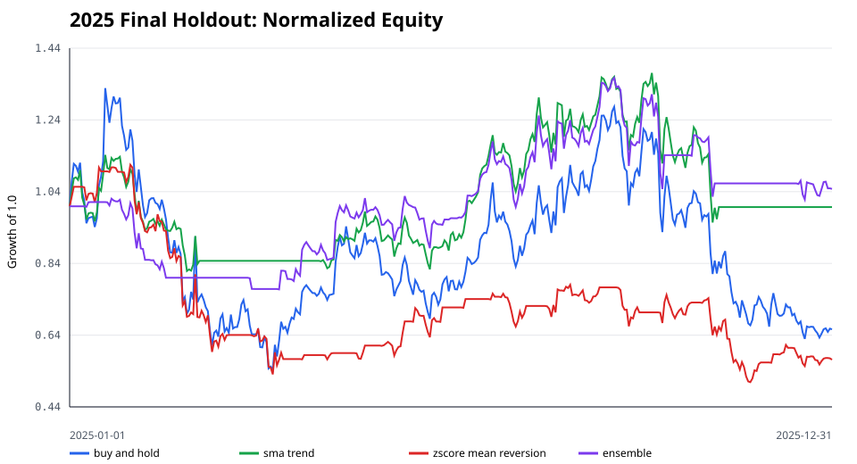
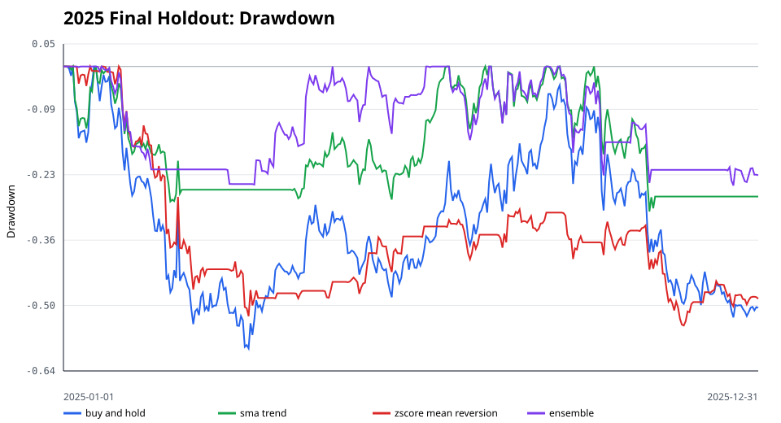
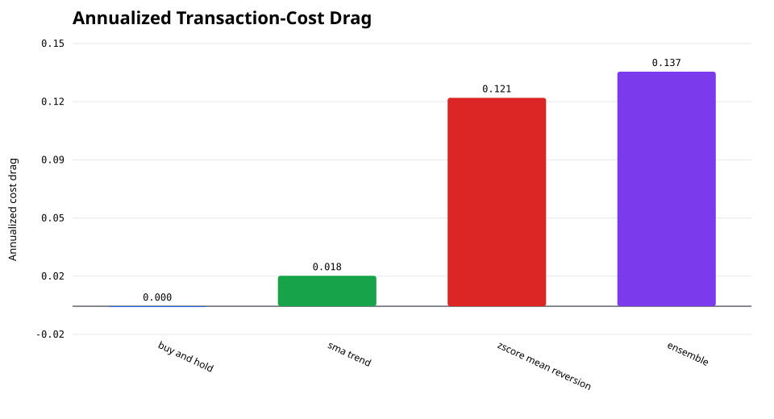
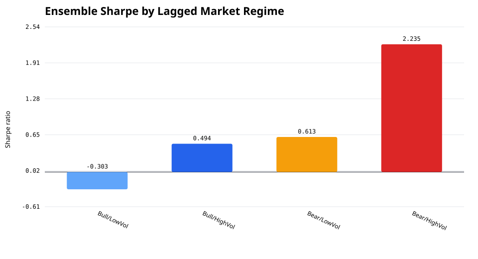
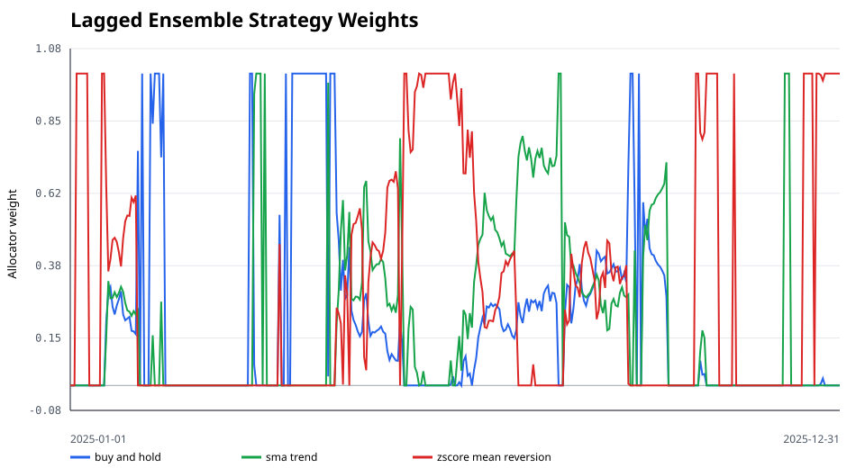

# Blockchain-Anchored Multi-Strategy Portfolio Back-testing and Execution Framework

**LI Maocheng · ZHOU Zijian · ZHENG Yige** 
MSBD5017 Course Project · Final technical report · 15 November 2026

## Abstract

Conventional backtests often report performance without preserving the exact data snapshot, configuration, execution assumptions, or calculation path that produced the result. This project tests whether deterministic execution plus an EVM-anchored cryptographic commitment can make a multi-strategy portfolio backtest independently reproducible, selectively auditable, and tamper-evident. We implement three long/cash strategies—buy-and-hold, moving-average trend, and z-score mean reversion—and a one-period-lagged reliability/inverse-volatility ensemble. A cost-aware engine records orders, fills, cash, positions, equity, turnover, commission, slippage, and risk metrics. A canonical 568-leaf evidence bundle is committed by an ordered, domain-separated SHA-256 Merkle tree and anchored in a Solidity registry on a local EVM.

The final 2025 holdout was opened once after parameter freeze. The ensemble returned 4.83%, with 45.00% annualized volatility, Sharpe 0.329, Sortino 0.490, and 24.90% maximum drawdown. These figures are evidence about one experiment, not a profitability claim. The reproducibility result is stronger: ten isolated replays produced byte-identical artifacts and the same Merkle root, all 568 inclusion proofs verified, a real depth-10 proof verified on chain, and 100 seeded one-byte mutations were detected and localized. Evidence construction added approximately 7.18% runtime overhead in the measured environment.

## 1. Research question and contribution

The research question is: **to what extent can deterministic execution plus an EVM-anchored cryptographic commitment make a multi-strategy portfolio backtest independently reproducible, selectively auditable, and tamper-evident?**

The system supports the claim in three bounded senses:

1. **Reproducibility:** frozen inputs deterministically regenerate every result artifact and the same root.
2. **Selective auditability:** an auditor can verify one artifact using its path-bound inclusion proof without publishing a new on-chain record.
3. **Tamper evidence:** changing one byte changes the leaf and root relationship, and the verifier identifies the affected file.

Blockchain does **not** prove that Binance source data are true, that the strategy is economically sound, or that the reported strategy will remain profitable. It timestamps and attributes a commitment to specific bytes.

## 2. Experimental design

### 2.1 Data and time semantics

The fixed snapshot contains daily BTCUSDT, ETHUSDT, and SOLUSDT bars from Binance Vision in UTC, covering 1 January 2021 through 31 December 2025. Data through 2024 are development data; calendar year 2025 is the final holdout. Checksums, source URLs, timestamp units, row counts, and normalized-file identity are preserved in the data manifest.

The no-look-ahead convention is fixed throughout the system: information through the close of day `t` forms a target, execution occurs on `t+1`, and the position then earns subsequent returns. In array notation, realized portfolio return is `weight[t-1] × return[t]`. Ensemble reliability and volatility for day `t` use base-strategy returns only through `t-1`.

### 2.2 Strategies, allocator, and costs

The base strategies are buy-and-hold, SMA trend, and stateful z-score mean reversion. Walk-forward selection evaluated 20 bounded candidates over four validation folds. The selection rule prioritized median validation net Sharpe, then worst-fold maximum drawdown, median turnover, and canonical parameter JSON. The selected candidate had median validation Sharpe 1.413 and froze the following parameters before the holdout:

| Component | Frozen parameters |
| --- | --- |
| SMA trend | fast 10 days; slow 150 days |
| Mean reversion | lookback 10; entry z = -0.50; exit z = -0.25 |
| Ensemble | reliability window 30; volatility window 30 |

The simulator starts with 10,000,000 USDT, permits long/cash allocations only, and uses fixed commission and slippage assumptions of 10 bps and 5 bps. Position and order generation obey deterministic symbol ordering and eight-decimal quantity precision. Sensitivity analysis changes one parameter or cost at a time by ±20%; it is used only for interpretation, never for reselection.

## 3. Deterministic evidence architecture

All canonical inputs, configuration, source identity, strategy outputs, ledgers, metrics, and deterministic events enter the evidence bundle. Paths are NFC-normalized and ordered by UTF-8 bytes. A leaf is:

`SHA256(0x00 || uint32_be(path_length) || path || uint64_be(content_length) || content)`

An internal node is `SHA256(0x01 || left || right)`. Explicit left/right directions prevent the ambiguity of sorted-pair trees. Merkle proofs and chain receipts are created after the root and are therefore excluded from that root.

The frozen bundle has run ID `098376de7f855b9e`, 568 leaves, and root:

`05136f84d6b1faa9226fd7b1a58b691707dc90be18688a2485fcbc3b7defa532`

The Solidity registry stores the root, submitter, block timestamp, and metadata hash. Its proof function uses the EVM SHA-256 precompile and the same ordered node rule as the offline verifier.

## 4. Final holdout results

| Strategy | Return | Volatility | Sharpe | Sortino | Max drawdown | Cost drag | Avg. exposure |
| --- | ---: | ---: | ---: | ---: | ---: | ---: | ---: |
| Buy-and-hold | -32.55% | 83.60% | -0.056 | -0.082 | 58.95% | 0.00% | 100.00% |
| SMA trend | 1.25% | 47.17% | 0.263 | 0.370 | 30.34% | 1.77% | 69.04% |
| Z-score mean reversion | -42.13% | 54.38% | -0.730 | -0.974 | 54.17% | 12.14% | 58.08% |
| Ensemble | **4.83%** | 45.00% | **0.329** | **0.490** | **24.90%** | 13.66% | 51.94% |

The ensemble had the best final return and drawdown among the tested strategies, but transaction costs were economically material. Reducing commission by 20% raised its return to 6.53%; increasing commission by 20% reduced it to 3.29%. This dependence and the modest Sharpe ratio argue against interpreting the outcome as robust alpha.

### 4.1 Market regimes and allocation

Regimes use lagged trend and volatility labels. The ensemble was strongest in the 64 Bear/HighVol observations (Sharpe 2.235) and weakest in the 157 Bull/LowVol observations (Sharpe -0.303). These conditional estimates use small, unequal samples and are descriptive rather than causal.

## 5. Verification and quality results

| Gate | Result |
| --- | --- |
| Accounting residual | below `1e-10` |
| Deterministic evidence construction | 10/10 identical roots |
| Offline inclusion proofs | 568/568 valid |
| Solidity tests | 5/5, including 512-run fuzz test |
| Real on-chain proof | depth 10, valid |
| Root submission gas | 69,175 |
| Proof estimate, depth 1 / 5 / 10 | 27,302 / 33,605 / 41,473 gas |
| Full clean replay | 10/10 byte-identical artifacts and roots |
| Seeded one-byte mutations | 100/100 detected and localized |
| Core test coverage | minimum 85.0% |
| Evidence runtime overhead | 7.18% |

The root was submitted on local chain ID 31337 to registry address `0x5fbdb2315678afecb367f032d93f642f64180aa3`. Duplicate and zero roots were rejected; event fields matched public storage; changing the leaf, a sibling, or a direction bit invalidated the proof.

## 6. Interpretation and limitations

The experiment demonstrates a practical separation between computation and commitment: large artifacts stay off chain, while a small on-chain root enables later verification. Deterministic replay is the primary reproducibility mechanism; blockchain adds attribution, ordering, and resistance to silent post-hoc replacement.

Important limitations remain. The deployment uses a local EVM and therefore makes no public-finality claim. The system does not authenticate the economic truth of source data. Daily bars and fixed linear costs omit order-book impact, liquidity, taxes, borrow costs, and corporate actions. Only long/cash portfolios are considered. Regime samples are limited, and the parameter search evaluates a bounded set of 20 candidates rather than finding a global optimum. No inference should be made beyond the fixed assets, period, and assumptions.

## 7. Conclusion

Within the frozen scope, the answer to the research question is affirmative but bounded. Deterministic execution makes the experiment reproducible; canonical serialization and ordered SHA-256 proofs make artifacts selectively auditable; and an EVM registry makes the frozen commitment tamper-evident and attributable. The strongest contribution is not the ensemble's 2025 return, but the complete, testable chain from pinned input bytes to accounting records, result artifacts, Merkle root, on-chain record, and independent replay.

## References

1. D. H. Bailey, J. M. Borwein, M. López de Prado, and Q. J. Zhu, “The Probability of Backtest Overfitting,” *Journal of Computational Finance*, 20(4), 39–69, 2017.
2. X. Liang et al., “ProvChain: A Blockchain-Based Data Provenance Architecture in Cloud Environment with Enhanced Privacy and Availability,” *IEEE/ACM CCGRID*, 2017.
3. A. J. Akbarfam et al., “ForensiBlock: A Blockchain-Based Digital Forensics Framework,” arXiv:2308.03927, 2023.
4. Ethereum Foundation, “Blockchain Data Storage Strategies.”
5. OpenZeppelin, “Contracts Cryptography Documentation.” The project does not use OpenZeppelin's sorted-pair Keccak Merkle verifier; this reference motivates the explicit compatibility boundary.
